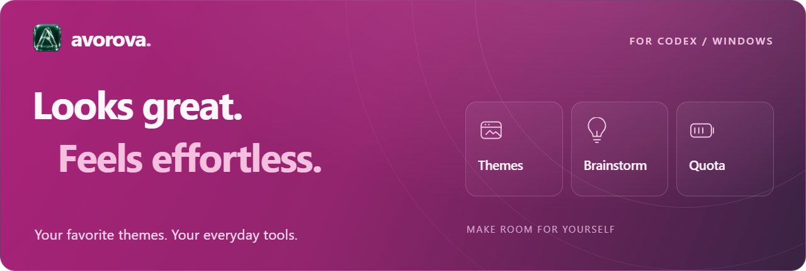
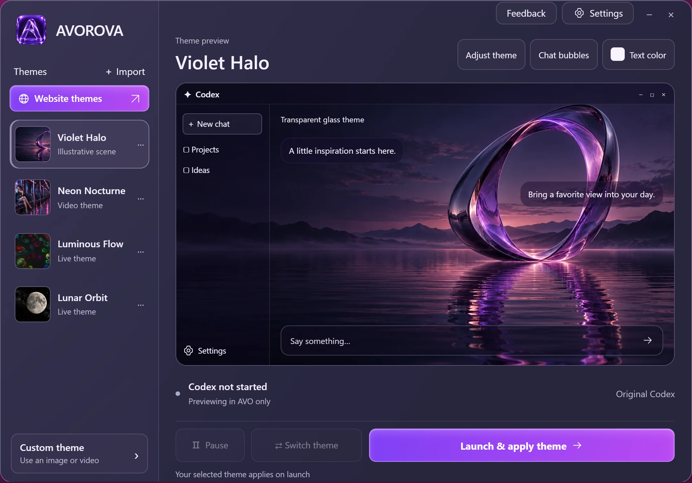
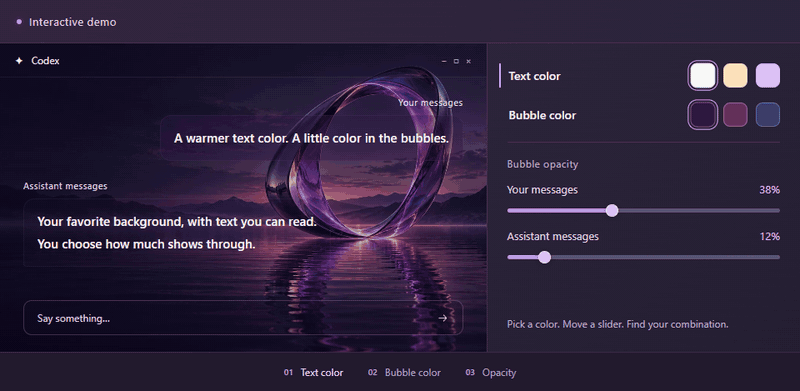
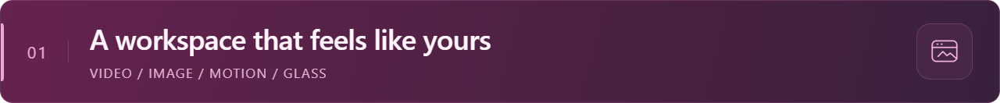
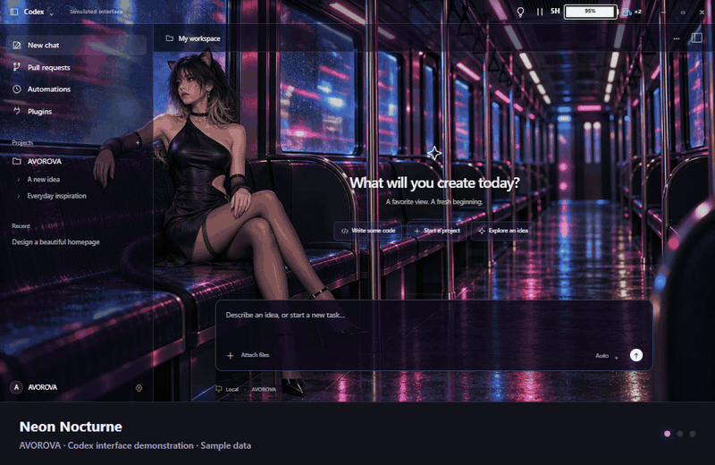
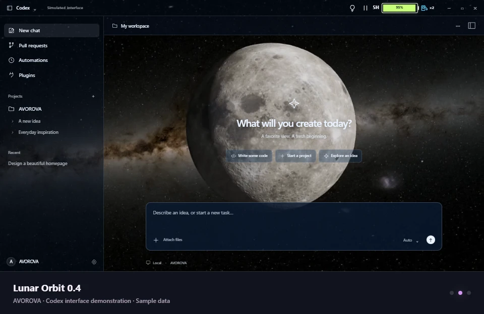
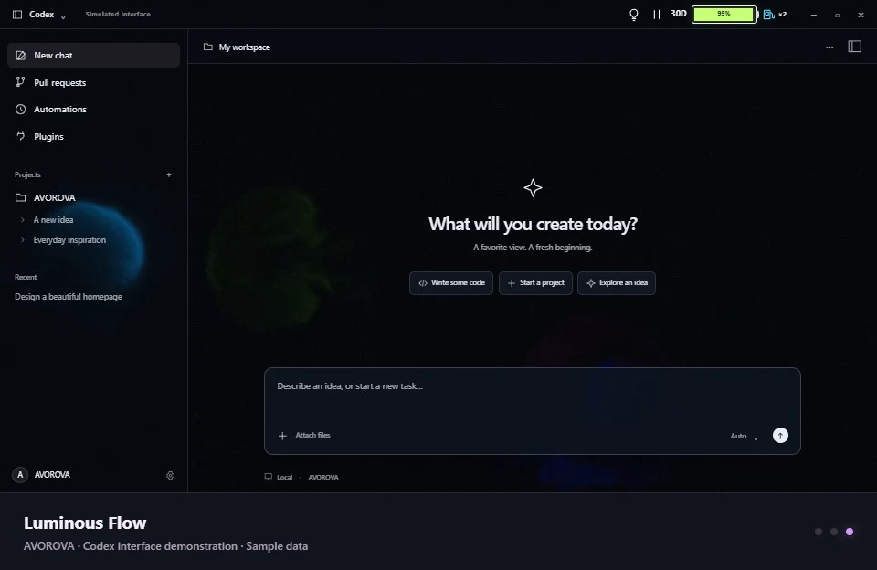
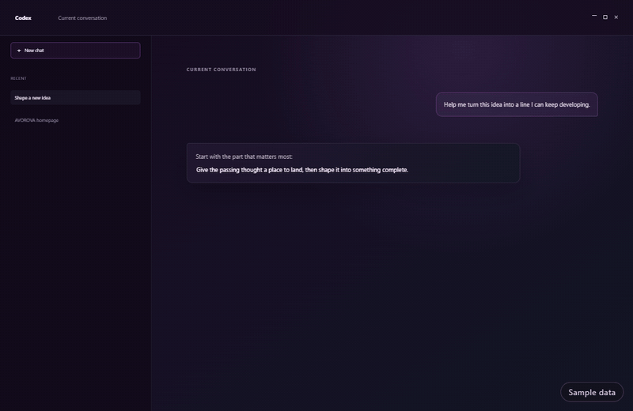
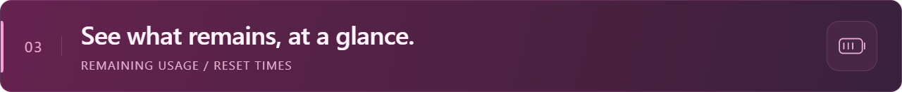
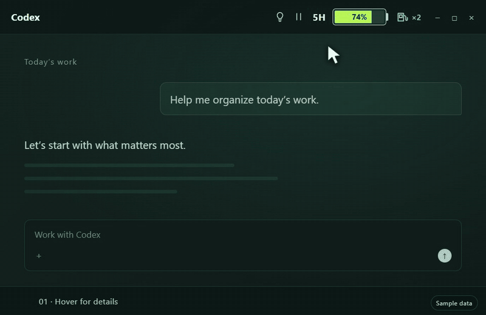

<h1 align="center">
  
</h1>

Themes, skins, live wallpapers, and customization tools for the ChatGPT desktop app / Codex on Windows, with ideas and quota right within reach.

  <a href="README.md">简体中文</a> · English · <a href="https://avorova.app/?utm_source=github">Website</a> · <a href="docs/FAQ.en.md">FAQ</a> · <a href="mailto:8849412@qq.com">Contact</a>

  

<strong>Website access:</strong> Some proxy connections may fail to load the website. Try setting <code>avorova.app</code> and <code>www.avorova.app</code> to DIRECT in your proxy app, or temporarily disconnect the proxy and retry. <a href="docs/FAQ.en.md#what-if-the-website-will-not-open">Troubleshooting</a>

  <a href="#meet-avorova">Interface</a> · <a href="#text-and-bubbles">Text &amp; bubbles</a> · <a href="#themes">Themes</a> · <a href="#brainstorm">Brainstorm</a> · <a href="#quota-battery">Quota battery</a> · <a href="#compatibility">Compatibility</a> · <a href="#availability">Availability</a>

> **V6.0.1 · Windows x64:** [Website download](https://avorova.app/#download) · [GitHub download](https://github.com/campbelljian/AVOROVA/releases/tag/v6.0.1) · [Setup and release notes](docs/RELEASE-V6.0.1.md#english). Website downloads are hosted on our own server and do not require GitHub access.

## What is AVOROVA?

AVOROVA is a theme and skin manager for the ChatGPT desktop app / Codex on Windows, with its own dedicated interface. Use image backgrounds, video wallpapers, animated backgrounds, or transparent glass themes inside the workspace you open every day.

OpenAI now calls the desktop application **ChatGPT**, with Codex still available inside it. The themes and demonstrations here focus on the Codex interface; supported app versions will be listed in the release notes. [Learn about naming and compatibility](docs/FAQ.en.md#which-product-does-it-work-with).

It also puts **Brainstorm** and a **quota battery** in the Codex title bar, so you can keep a passing idea and check your remaining Codex plan usage without leaving your work.

## Meet AVOROVA

Choose a theme, preview it, and apply it. Your theme library, preview, and everyday settings are together in one window.

The first release is designed for **original Codex**: choose a theme, preview it, then select “Launch & apply theme”. Once running, you can pause motion or switch themes.

*Interface illustration matching the website, with a concept background. The actual interface and bundled themes depend on the release version. [View the actual V6.0.1 interface (Chinese)](assets/app-interface-v6.0.1-zh.png).*

- **Manage and preview themes:** import a theme and see its appearance before applying it.
- **Make adjustments:** adjust the theme, conversation bubbles, and text color.
- **Create your own themes:** use your own images or videos.
- **Control motion:** pause and resume playback from the Codex title bar.

## Text and bubbles

**Your text. Your bubbles. Your way.** Choose text and bubble colors, then adjust the opacity of your messages and assistant replies separately. Keep your favorite background and your conversations easy to read.

*Recorded from the website's interactive demo, not the desktop app. Color adjustments affect the illustration only; adjust your actual theme in AVOROVA.*

## Themes

The theme library includes video, image, motion, and glass themes, bringing wallpapers and backgrounds into the Codex sidebar, composer, and workspace. Watch a live preview, then download a theme package or let AVOROVA download, import, and apply it from the website.

*See the theme, sidebar, composer, and title-bar tools together. The loop shows three themes; [open the Neon Nocturne still](assets/neon-window-en.webp) for a closer look.*

*Animations are recordings of website interface demonstrations, not desktop recordings. The Brainstorm panel is rendered from the current app interface with sample data. All conversations, notes, and quota values are examples.*

| Lunar Orbit · Moon and stars | Luminous Flow · Colors in motion |
| :---: | :---: |
|  |  |

*Open either image to see the full window. The animation above shows motion; these stills make interface details easier to inspect.*

Motion themes have been tested by the author and use CPU and GPU resources. On less powerful computers, choose according to actual performance. [Motion theme notes](docs/FAQ.en.md#can-motion-themes-affect-performance).

## Brainstorm

Select a passage from a user message or assistant reply in Codex and choose “Save to Brainstorm” to keep developing the idea.

- Write notes, paste images, and save changes automatically on your computer.
- Keep the excerpt and its source, then use “Copy to clipboard” or “Return to source window.”
- Open the panel from the title bar when needed, then return to your work.

Returning to the source window does not guarantee navigation to an exact historical message. That behavior continues to be adapted as Codex changes.

*Select text → save to Brainstorm → develop the idea. [Open the panel close-up](assets/brainstorm-en.png). The panel is labeled “Ideas” in this preview.*

## Quota battery

The title-bar battery shows remaining Codex plan quota. Hover over it for details.

- Remaining usage for periods such as the five-hour and weekly windows.
- Reset times and countdowns.
- A read-only reset-card count, when that information is available.

*Hover over the battery → inspect usage and reset times → move away to close. [Open the quota details close-up](assets/quota-en.png).*

*Percentages, times, and card counts are sample data. Available information depends on the account; the battery does not increase or reset plan limits.*

## Compatibility

**An unlisted Codex version is not necessarily incompatible.** Codex has updated frequently during development, and AVOROVA has undergone multiple rounds of compatibility work. Existing records cover runtime tests on at least **17 Windows Store package versions**. This is a verification history, not an allowlist; other versions may work too.

The most recently verified **Codex application version is 26.1027.30824**, corresponding to Windows Store package **26.1027.3384.0**. Both numbers identify the same Codex installation.

Historical tests differ in scope, and the current AVOROVA build has not been retested against every older package. [See the full version history and known boundaries](docs/COMPATIBILITY.en.md).

## Availability

| Item | Current status |
| --- | --- |
| Platform | ChatGPT desktop app / Codex on Windows |
| How to use | Original Codex; use your existing sign-in, then launch and apply themes through AVOROVA |
| Quota display | Remaining Codex plan quota and reset times |
| Installer | **V6.0.1 · Windows x64**; [website](https://avorova.app/#download) / [GitHub Releases](https://github.com/campbelljian/AVOROVA/releases/tag/v6.0.1) |
| Compatibility record | [Verified versions and compatibility notes](docs/COMPATIBILITY.en.md); not a version allowlist |
| Theme community | Not open yet |
| Repository purpose | Product information, documentation, and release materials |

[Setup, bundled themes, and file verification](docs/RELEASE-V6.0.1.md#english). This repository does not contain the AVOROVA application source code or Codex source code.

The V6.0.1 installer has no Windows publisher signature, so Windows may show a prompt during installation. [View installation notes](docs/FAQ.en.md#what-if-i-see-a-security-warning-during-installation).

## Learn more

- [Website](https://avorova.app/?utm_source=github)
- [Frequently asked questions](docs/FAQ.en.md)
- [中文介绍](README.md)
- [Contact the author: 8849412@qq.com](mailto:8849412@qq.com)

Questions and suggestions are welcome. For a bug report, include your AVOROVA and Codex versions, steps to reproduce, and relevant screenshots. Do not send passwords or API keys.

---

**How themes work**

AVOROVA’s theme customization does not rewrite Codex’s original installation files; theme effects load at runtime.

AVOROVA is an independent project, not affiliated with or endorsed by OpenAI. The ChatGPT and Codex names identify the products it works with.
