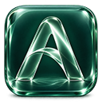
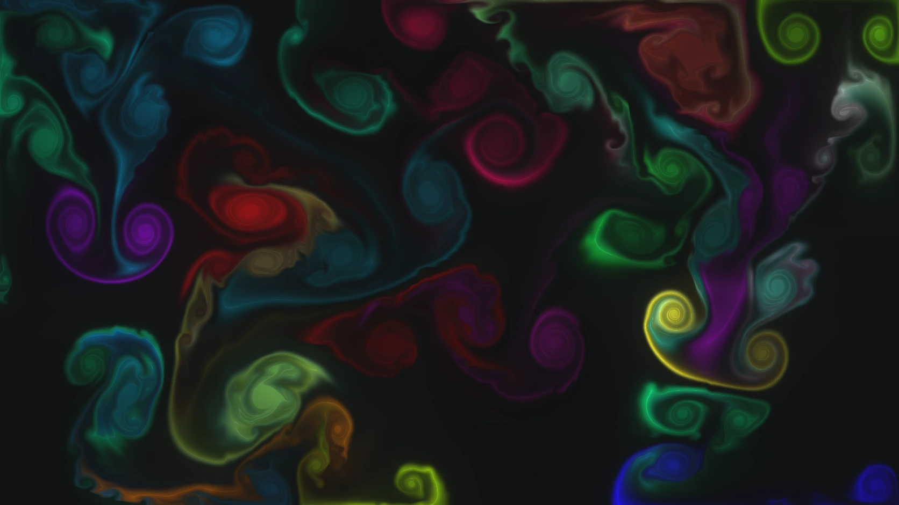
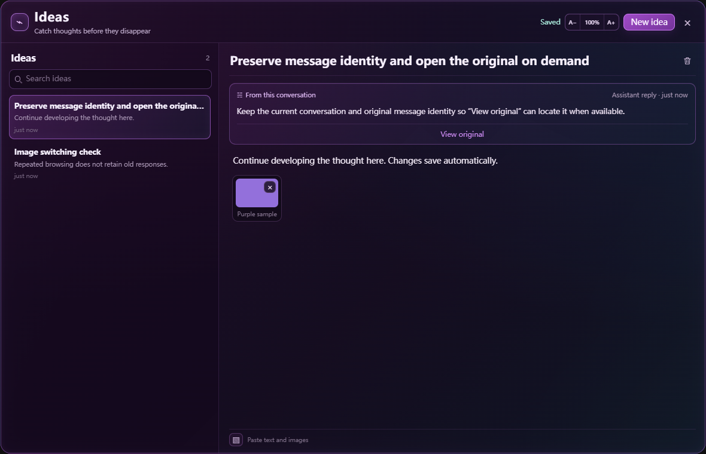
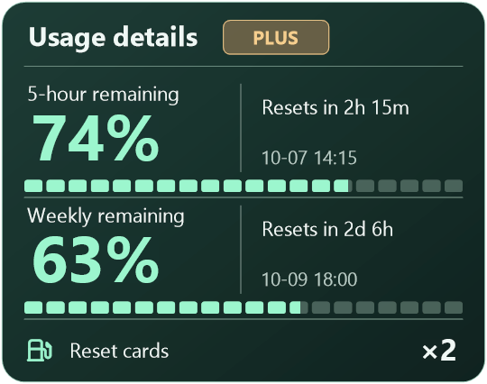

  

<h1 align="center">AVOROVA</h1>

<strong>Looks great. Feels effortless.</strong>

Themes and everyday tools for Codex on Windows, with ideas and quota right within reach.

  <a href="README.md">简体中文</a> · English · <a href="https://avorova.app/">Website</a> · <a href="docs/FAQ.en.md">FAQ</a>

> **Preparing for release:** this repository currently contains a product overview and interface previews. No installer is available yet.

*Neon Nocturne · Theme artwork. This is a still image, not the video theme playing in the app.*

## What is AVOROVA?

AVOROVA, or AVO, brings visual themes and useful companion tools to the Windows Codex desktop app. Choose a quiet lunar scene, flowing colors, or a cinematic video background for the workspace you open every day.

It also puts **Brainstorm** and a **quota battery** in the Codex title bar, so you can keep a passing idea and check your remaining plan usage without leaving your work.

## A workspace that feels like yours

The theme library includes video, image, motion, and glass themes. Preview a theme before choosing a look.

| Lunar Orbit · Moon and stars | Luminous Flow · Colors in motion |
| :---: | :---: |
|  |  |

*These are still previews of theme artwork. Animated themes do not play inside these images.*

## Brainstorm: keep the thought

Select a passage in a Codex conversation and choose “Save to Brainstorm” to keep developing the idea.

- Write notes, paste images, and save changes automatically on your computer.
- Keep a reference to the original conversation and message, and revisit it when it can be located.
- Open the panel from the title bar when needed, then return to your work.

*Interface preview with sample content. The panel is labeled “Ideas” in this preview.*

## Quota battery: see what remains

The title-bar battery shows remaining Codex usage. Hover over it for details.

- Remaining usage for periods such as the five-hour and weekly windows.
- Reset times and countdowns.
- A read-only reset-card count, when that information is available.

*Percentages, times, and card counts are sample data. Available information depends on the account; the battery does not increase or reset plan limits.*

## Availability

| Item | Current status |
| --- | --- |
| Platform | Codex desktop app on Windows |
| Installer | In preparation; no download is available in this repository |
| Compatibility | Supported Windows and Codex versions will be listed with the release |
| Theme community | Not open yet |
| Repository purpose | Product information, documentation, and future release materials |

Installation, update, and compatibility instructions will accompany a verified installer. This repository does not contain the AVO application source code or Codex source code.

## Learn more

- [Website](https://avorova.app/)
- [Frequently asked questions](docs/FAQ.en.md)
- [中文介绍](README.md)

AVOROVA is an independent project, not affiliated with or endorsed by OpenAI. The Codex name identifies the product it works with.
