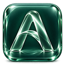
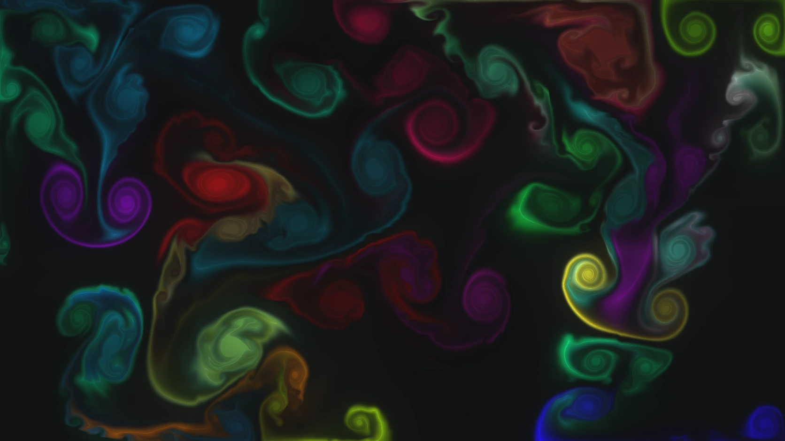
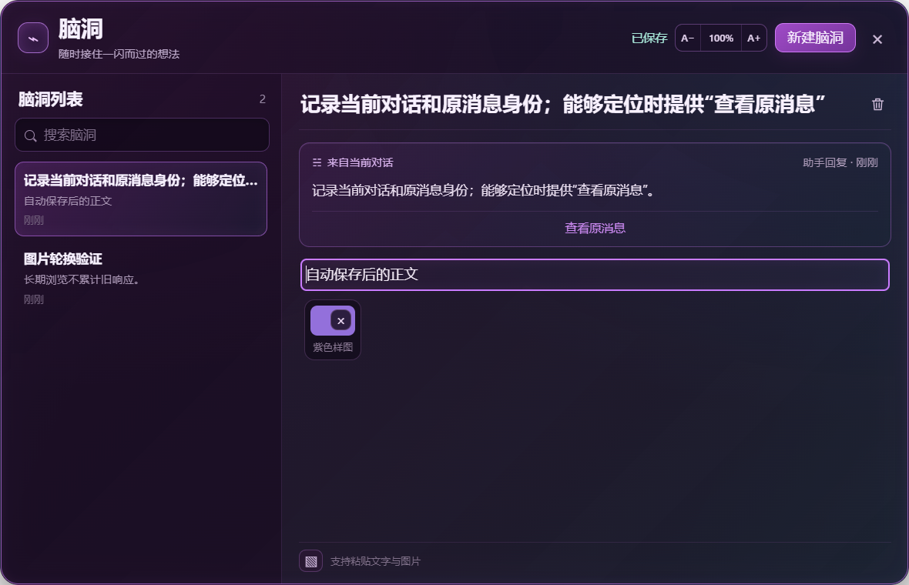
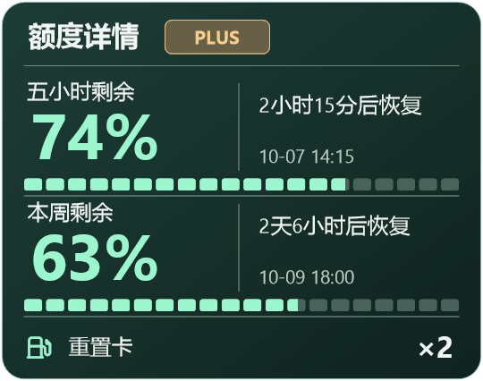

  

<h1 align="center">AVOROVA</h1>

<strong>超好看，超方便。</strong>

给 Windows 版 Codex 换上喜欢的主题，把灵感和额度放在顺手的位置。

  简体中文 · <a href="README.en.md">English</a> · <a href="https://avorova.app/">官网</a> · <a href="docs/FAQ.zh-CN.md">常见问题</a>

> **发布准备中**：当前仅提供产品介绍与界面预览，安装包尚未发布。

*霓影夜轨 · 主题画面示例。此处为静态图片，视频效果以实际主题为准。*

## AVOROVA 是什么？

AVOROVA（简称 AVO）是为 Windows 版 Codex 制作的主题与实用功能工具。喜欢安静的月面、流动的色彩，或有故事感的视频场景，都可以给每天打开的工作窗口换一种感觉。

除了外观，AVO 还把**脑洞**和**额度电池**放进 Codex 顶栏：随手留下想法，也能随时看看套餐还剩多少额度。

## 换个喜欢的工作画面

主题库提供视频、图片、动效与玻璃类主题。先看预览，再选择适合自己的风格。

| Lunar Orbit · 月面与星空 | 流光幻境 · 流动的色彩 |
| :---: | :---: |
|  |  |

*以上是主题画面的静态预览；动效类主题的实际运动效果不在这些图片中播放。*

## 脑洞：闪过的想法，先接住

在 Codex 对话里选中一段文字，点“存入脑洞”，就能接着整理自己的想法。

- 继续写字、粘贴图片，内容自动保存在本机。
- 保留原对话和原消息的关联；能够定位时，可返回查看上下文。
- 需要时从顶栏打开，写完再回到当前工作。

*界面演示使用示例内容。*

## 额度电池：剩多少，一眼看清

Codex 顶栏里的电池显示剩余额度，悬停即可查看更详细的信息。

- 五小时、本周等额度周期的剩余情况。
- 额度恢复时间与倒计时。
- 只读显示可用的重置卡数量。

*百分比、时间和卡片数量均为示例数据。实际显示取决于账号可提供的数据；电池本身不会增加或重置套餐额度。*

## 适用范围与下载状态

| 项目 | 当前说明 |
| --- | --- |
| 平台 | Windows 桌面版 Codex |
| 安装包 | 准备中，本仓库暂未提供下载 |
| 兼容范围 | 具体 Windows、Codex 版本以正式发布说明为准 |
| 主题社区 | 暂未开放 |
| 仓库用途 | 产品介绍、使用说明，以及后续的版本发布资料 |

安装、更新与完整兼容说明会随经过验证的安装包一起补齐。当前仓库不包含 AVO 主程序源码，也不包含 Codex 源码。

## 了解更多

- [官方网站](https://avorova.app/)
- [常见问题](docs/FAQ.zh-CN.md)
- [English introduction](README.en.md)

AVOROVA 是独立项目，与 OpenAI 没有隶属关系，也未获得其官方背书。Codex 名称用于说明适用的产品。
