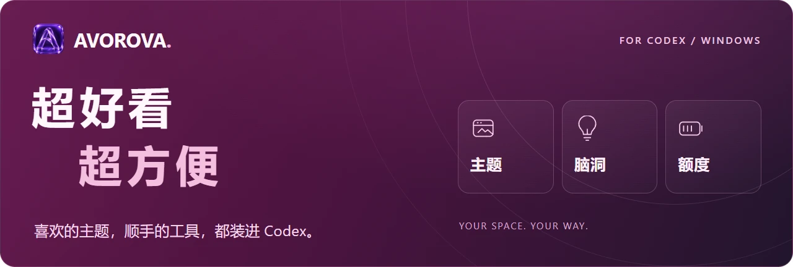
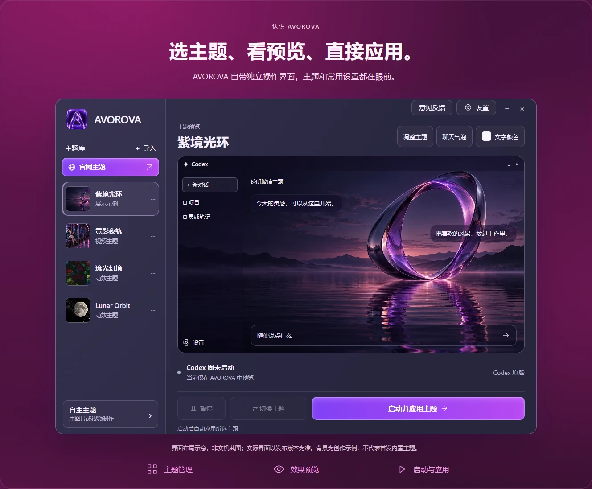
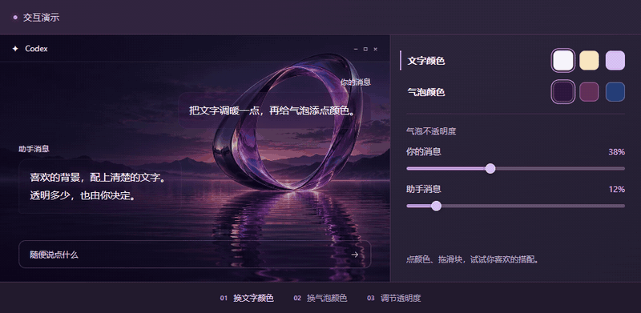
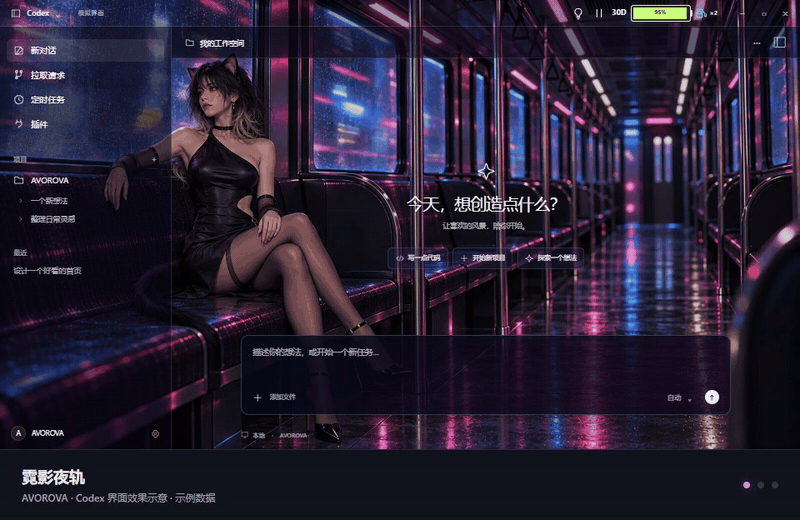
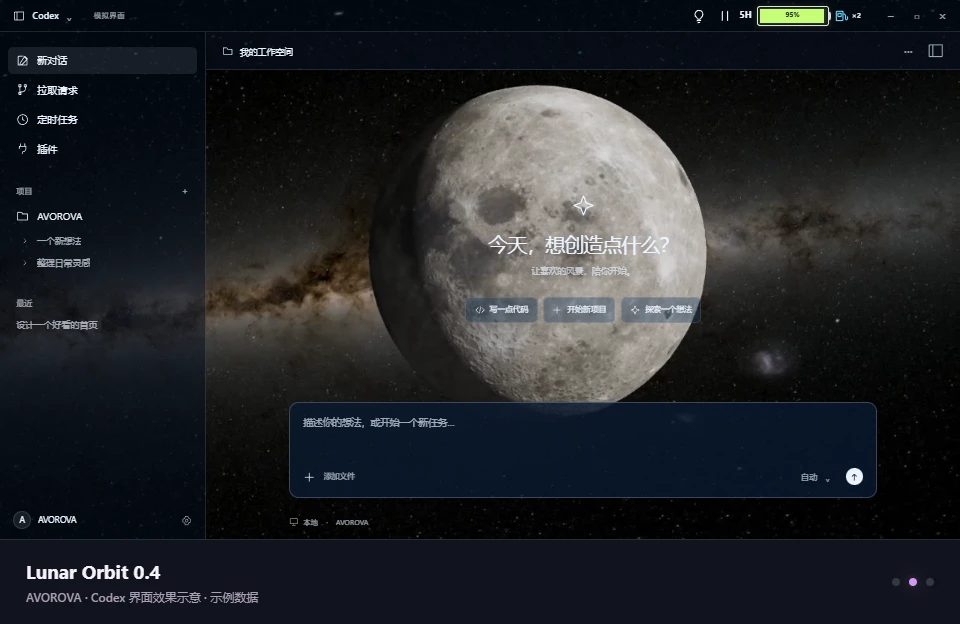
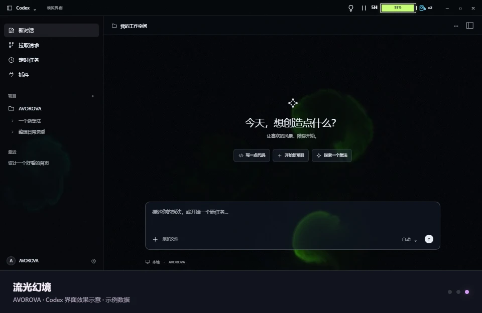
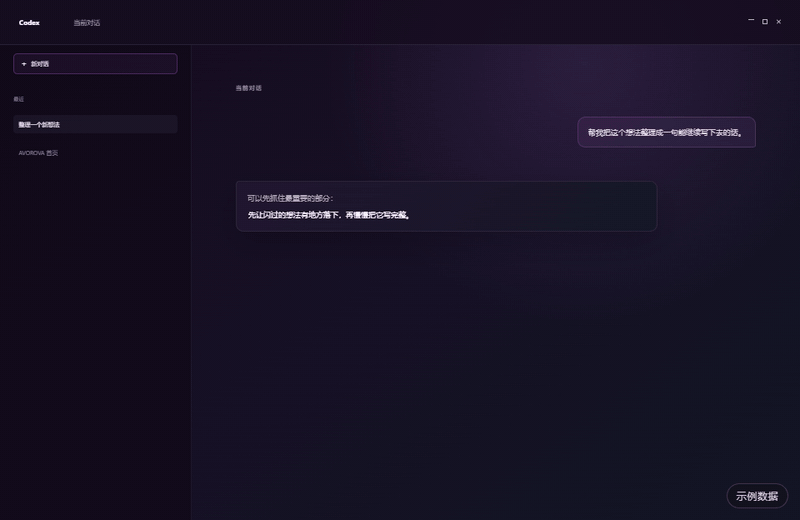
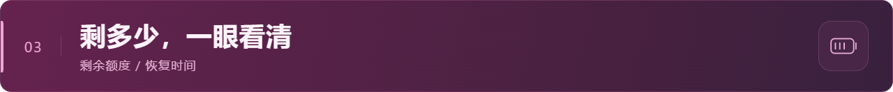
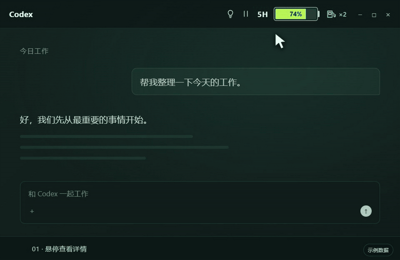

<h1 align="center">
  
</h1>

为 Windows 版 ChatGPT / Codex 提供主题换肤、动态壁纸和实用工具，把灵感和额度放在顺手的位置。

<strong>支持 Codex 主题模式与 Codex++ 模式，中转站用户也能用。</strong>

  简体中文 · <a href="README.en.md">English</a> · <a href="https://avorova.app/?utm_source=github">官网</a> · <a href="docs/FAQ.zh-CN.md">常见问题</a> · <a href="mailto:8849412@qq.com">联系作者</a>

  

<strong>官网访问提示：</strong>部分代理环境可能导致官网无法打开。可尝试将 <code>avorova.app</code> 和 <code>www.avorova.app</code> 设为直连（DIRECT），或暂时关闭代理后重试。<a href="docs/FAQ.zh-CN.md#官网打不开怎么办">查看排查方法</a>

  <a href="#认识-avorova">主界面</a> · <a href="#文字与气泡">文字与气泡</a> · <a href="#主题">主题</a> · <a href="#脑洞">脑洞</a> · <a href="#额度电池">额度电池</a> · <a href="#兼容性">兼容性</a> · <a href="#适用范围与下载状态">下载状态</a>

> **发布准备中**：当前仅提供产品介绍与界面预览，安装包尚未发布。

## AVOROVA 是什么？

AVOROVA 是一款面向 Windows 版 ChatGPT 桌面应用 / Codex 的主题管理与换肤美化工具，拥有独立的操作界面。用图片背景、视频壁纸、动态背景或玻璃透明皮肤，给每天打开的工作窗口换一种感觉。

官方当前使用 **ChatGPT 桌面应用**这个名称，应用中仍保留 Codex。本文中的主题与操作演示围绕 Codex 界面展开；具体兼容版本以发布说明为准。[了解名称与适用范围](docs/FAQ.zh-CN.md#它适用于什么产品)。

你可以使用 **Codex 主题模式**，也可以通过 **Codex++ 模式**搭配中转服务使用主题。Codex++ 模式需要另行安装 Codex++，并在其中配置好自己的中转服务；普通主题模式无需安装 Codex++。

除了外观，AVOROVA 还把**脑洞**和**额度电池**放进 Codex 顶栏：随手留下想法，也能随时看看 Codex 套餐还剩多少额度。额度电池暂不显示中转站余额。

## 认识 AVOROVA

选主题、看预览、直接应用。主题列表、效果预览和常用设置，都在同一个窗口里。

*界面示意；预览背景是为展示创作的示例，并非上架主题。*

- **主题管理与预览**：导入主题，在应用前查看效果。
- **按喜好调整**：调整主题、聊天气泡和文字颜色。
- **自主主题**：用自己的图片或视频制作主题。
- **动态主题控制**：在 Codex 顶栏暂停、继续播放。
- **双模式启动**：选择 Codex 主题模式或 Codex++ 模式。

## 文字与气泡

**文字和气泡，调成你喜欢的样子。** 自由调整文字与聊天气泡的颜色，分别设置自己和助手消息的透明度。搭配喜欢的背景，让聊天清楚又舒服。

*动图录自官网交互演示，并非桌面录屏。演示中的调色只影响示例画面，实际主题设置请在 AVOROVA 中调整。*

## 主题

主题库提供视频、图片、动效与玻璃类主题，让壁纸和背景融入 Codex 的侧栏、输入框与工作界面。先看动态预览，再下载主题包或通过网页交给 AVOROVA 下载、入库与应用。

*主题、侧栏、输入框和顶栏工具，一起看。动图循环展示三款主题；[查看霓影夜轨静态大图](assets/neon-window-zh.webp)。*

*本页动图录自官网界面演示，并非实际桌面录屏；脑洞面板由当前程序界面使用示例数据渲染。所有对话、笔记和额度均为演示内容。*

| Lunar Orbit · 月面与星空 | 流光幻境 · 流动的色彩 |
| :---: | :---: |
|  |  |

*点击图片可放大查看完整窗口。上方动图展示动态效果，下方图片方便看界面细节。*

动效主题已由作者实机测试，运行时会占用一定的处理器和显卡资源。配置较低的电脑建议根据实际流畅度选用。[动效主题使用说明](docs/FAQ.zh-CN.md#动效主题会影响电脑性能吗)。

## 脑洞

在 Codex 对话里选中用户消息或助手回复中的一段文字，点“存入脑洞”，就能接着整理自己的想法。

- 继续写字、粘贴图片，内容自动保存在本机。
- 保留摘录和来源，可“复制到剪贴板”或“返回原窗口查看”。
- 需要时从顶栏打开，写完再回到当前工作。

返回原窗口不等于精确定位到历史消息；这部分会随 Codex 更新持续适配。

*框选文字 → 存入脑洞 → 继续整理想法。[查看脑洞面板大图](assets/brainstorm-zh.png)。*

## 额度电池

Codex 顶栏里的电池显示 Codex 套餐的剩余额度，悬停即可查看更详细的信息。**暂不显示中转站余额。**

- 五小时、本周等额度周期的剩余情况。
- 额度恢复时间与倒计时。
- 只读显示可用的重置卡数量。

*悬停电池 → 查看额度和恢复时间 → 移开收起。[查看额度详情大图](assets/quota-zh.png)。*

*百分比、时间和卡片数量均为示例数据。实际显示取决于账号可提供的数据；电池本身不会增加或重置套餐额度。*

## 兼容性

**未列出的 Codex 版本，不代表不兼容。** Codex 在开发期间更新频繁，AVOROVA 已持续进行了多轮兼容适配。现有记录覆盖至少 **17 个 Windows 商店包版本**的真实运行测试；这是已验证记录，并非仅支持这些版本的名单，其他版本也可能正常使用。

最近验证的 **Codex 应用版本为 26.1027.30824**，对应 Windows 商店包 **26.1027.3384.0**。这两个编号属于同一个 Codex 安装包。

历史测试范围各不相同，也不表示当前 AVOROVA 已对全部旧版重新测试。[查看完整版本记录与已知边界](docs/COMPATIBILITY.zh-CN.md)。

## 适用范围与下载状态

| 项目 | 当前说明 |
| --- | --- |
| 平台 | Windows 版 ChatGPT 桌面应用 / Codex |
| 使用方式 | Codex 主题模式；Codex++ 模式（需另行安装并配置 Codex++，支持中转服务） |
| 额度显示 | Codex 套餐额度；暂不显示中转站余额 |
| 安装包 | 准备中，本仓库暂未提供下载 |
| 兼容记录 | [已验证版本与兼容说明](docs/COMPATIBILITY.zh-CN.md)；不是限制使用的版本名单 |
| 主题社区 | 暂未开放 |
| 仓库用途 | 产品介绍、使用说明，以及后续的版本发布资料 |

安装、更新与完整兼容说明会随经过验证的安装包一起补齐。当前仓库不包含 AVOROVA 主程序源码，也不包含 Codex 源码。

当前测试安装包尚未签名，安装时可能出现系统提示。[查看安装说明](docs/FAQ.zh-CN.md#安装时出现防护提示怎么办)。

## 了解更多

- [官方网站](https://avorova.app/?utm_source=github)
- [常见问题](docs/FAQ.zh-CN.md)
- [English introduction](README.en.md)
- [联系作者：8849412@qq.com](mailto:8849412@qq.com)

遇到问题或有建议，欢迎联系作者。反馈时附上 AVOROVA 与 Codex 版本、复现步骤和必要的截图即可，请勿发送密码或 API 密钥。

---

**运行方式说明**

AVOROVA 的主题美化功能不改写 Codex 原始安装文件，主题效果在运行时加载。

AVOROVA 是独立项目，与 OpenAI 没有隶属关系，也未获得其官方背书。ChatGPT 与 Codex 名称用于说明适用的产品。
